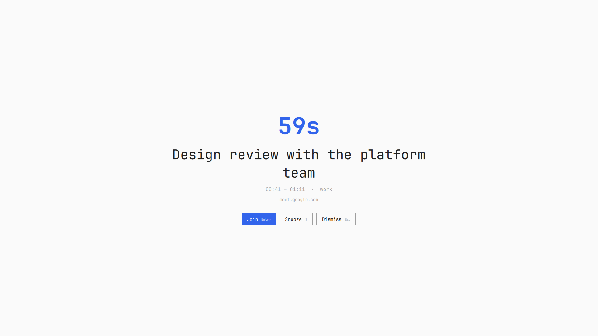

# Mokuzen

**目前 — mokuzen, "right before your eyes."**

You have never missed a meeting because your computer failed to tell you. You
missed it because it told you politely, in a corner, next to eleven other
things, and you scrolled past.

Mokuzen doesn't do polite. One minute before your meeting, it takes the whole
screen: what's starting, how long you have, and one key to join. Then it gets
out of the way.

<p align="center">
  
</p>

- **It reads your calendar. That's it.** Google, Outlook, iCloud, Nextcloud,
  or a folder of `.ics` files on disk — anything that speaks iCalendar. No
  account, no sync service, no telemetry. Nothing leaves your machine except
  the request that fetches the calendar you pointed it at.
- **Nothing to install.** The whole calendar stack — iCalendar parsing,
  recurrences, exceptions, time zones, meeting links — is Python standard
  library.
- **No background daemon of its own.** The Omarchy shell launches short-lived
  helper jobs only when needed, each with a hard deadline and bounded output.
- **One key to join.** Meet, Zoom, Teams, Webex, Whereby, Jitsi, Around,
  Gather, Slack huddles — found in the location, the description, the `URL`,
  or Google's conference field.

## Install

```bash
omarchy plugin add https://github.com/dedeanth/omarchy-mokuzen --enable
omarchy bar put io.github.dedeanth.mokuzen --section right
```

Then give it your calendar. Any calendar that can publish a private link
works — which is all of them. Yours is here:

| | |
| --- | --- |
| **Google** | Settings for my calendars → Integrate calendar → **Secret** address in iCal format |
| **Outlook / 365** | Settings → Calendar → Shared calendars → Publish → the ICS link |
| **iCloud** | share icon next to the calendar → Public Calendar → the `webcal://` link |
| **Nextcloud, Proton, any CalDAV** | the calendar's iCal export link — or just point Mokuzen at the folder your CalDAV client already syncs |
| **No cloud at all** | an `.ics` file on disk, or a folder of them |

On Google, take the **secret** address, not the public one: the public one
only exists if you have made the calendar public, and it will be empty.

Click **＋ Add a calendar** in the Mokuzen panel, paste, press `Enter`.

That's the whole setup. Mokuzen fetches the calendar straight away and tells
you how many events it found, so a wrong or revoked address fails in front of
you rather than silently at 9:59am.

## Configure

Everything lives in one owner-only file, `~/.config/omarchy/mokuzen.json`.
Three ways to write it, all equivalent — the panel and the command line go
through the same code:

**From the bar.** Click the Mokuzen entry. The panel holds your calendars
(addresses masked), the alert and snooze delays, and the ＋ button.

**From a terminal.**

```bash
cd ~/.config/omarchy/plugins/io.github.dedeanth.mokuzen
python3 bin/mokuzen-agenda setup --calendar "https://…/basic.ics"
python3 bin/mokuzen-agenda setup --lead 120 --snooze 300
python3 bin/mokuzen-agenda setup --show          # secrets masked
python3 bin/mokuzen-agenda setup --remove-calendar "https://…"
```

**By hand**, if you prefer — the file is plain JSON, and the shell picks up
saved changes within 15 seconds, with no restart.

`calendars` takes up to 32 sources, mixed freely — work in one, personal in
another. A folder counts as one source: a bounded number of regular `.ics`
files under it is read; symbolic links are not followed. Remote ones are
refetched every `refreshSeconds` and cached; when the network is down the
cached copy is used, and Mokuzen says so rather than pretending your day is
empty.

<details>
<summary><b>Every setting</b></summary>

| Key | Default | Meaning |
| --- | --- | --- |
| `calendars` | `[]` | URLs, files, or folders. Empty means Mokuzen does nothing. |
| `leadSeconds` | `60` | How long before the start the alert appears. |
| `pollSeconds` | `30` | How often the agenda is consulted. |
| `refreshSeconds` | `300` | How often remote calendars are refetched. |
| `snoozeSeconds` | `60` | How long the snooze key hides an alert. |
| `graceSeconds` | `120` | An event that started longer ago than this is not raised. |
| `autoDismissSeconds` | `0` | Close by itself this long after the start. `0` keeps it up. |
| `ignoreAllDay` | `true` | Skip all-day events. |
| `skipCancelled` | `true` | Skip cancelled events. |
| `skipDeclined` | `true` | Skip events you declined. |
| `selfEmails` | `[]` | Your addresses, used to recognise your own declines. A Google calendar's secret address already names its owner, so Google users can leave it empty. |
| `ignoreTitles` | `[]` | Regular expressions; a matching title never alerts. Good for recurring reminders that aren't meetings. |
| `onlyWithLink` | `false` | Only alert for events that carry a meeting link. |
| `maxMeetingHours` | `12` | Timed events longer than this — holidays, trips, "for information" blocks — never alert. `0` disables the limit. |
| `enabled` | `true` | Keep the plugin installed but silent. |

Two more live on the bar entry, because they're about the bar and not your
calendar:

```bash
omarchy bar set io.github.dedeanth.mokuzen label time          # countdown | time | title
omarchy bar set io.github.dedeanth.mokuzen hideWhenEmpty false --json
```

</details>

## When it fires

| Key | Action |
| --- | --- |
| `Enter` | Join the meeting, then dismiss |
| `S` | Snooze — it comes back after `snoozeSeconds`, even once the meeting has started |
| `Esc` | Dismiss until the meeting is over |

Keystrokes are ignored for the first three-quarters of a second, so whatever
you were typing when it appeared can't act on it by accident.

## In the bar

A calendar glyph and how long you have — `8h57`, `42m`, `<1m` — turning urgent
as the alert approaches. While a meeting is under way, the bar switches to
`En cours` with its remaining time; the panel shows its title separately above
the genuine future events in **Next up**. Left click opens the panel, middle click refetches.
It also answers on the `mokuzen` IPC target, if you'd rather bind a key:

```bash
omarchy-shell mokuzen toggle    # or open / close
```

Adding a calendar is deliberately a two-step gesture: the panel shows only a
button, and the address field appears when you press it, then vanishes on
`Enter`. A secret iCal address is a credential — an input box sitting open
with one in it gives it away to anyone glancing at your screen, and buys you
nothing.

## Something wrong?

The agenda reader is a plain command you can run yourself. Everything prints
JSON.

```bash
cd ~/.config/omarchy/plugins/io.github.dedeanth.mokuzen
python3 bin/mokuzen-agenda doctor         # what's configured, reachable, parseable
python3 bin/mokuzen-agenda list --days 7  # what it thinks is coming
python3 bin/mokuzen-agenda check          # what it would alert on right now
qs log -p "$OMARCHY_PATH/shell" --tail 100
```

To see the alert without waiting for a meeting:

```bash
omarchy-shell shell summon io.github.dedeanth.mokuzen '{"summary":"Test","start":'"$(( $(date +%s) + 60 ))"',"end":'"$(( $(date +%s) + 1860 ))"',"occurrenceId":"test","link":""}'
```

## Remove

```bash
omarchy plugin remove io.github.dedeanth.mokuzen
rm -f ~/.config/omarchy/mokuzen.json
rm -rf ~/.cache/mokuzen
```

Mokuzen writes nothing outside those two paths.

## How it works

Three entry points of one plugin, all inside the long-lived `omarchy-shell`
process. `Service.qml` asks `bin/mokuzen-agenda` what's about to start and
summons the alert. `Overlay.qml` is the fullscreen layer-shell surface.
`BarWidget.qml` is the bar entry and its panel. The shell hands the service to
the other two, so they share state in memory — no files passed between halves,
nothing about your calendar on disk beyond the `.ics` cache, which is
owner-only like the config that fetched it.

## The name

**目前** is 目 *me*, the eye, and 前 *mae*, in front of. Read in Japanese as
**mokuzen**: *right before your eyes*, and by extension *imminent* — the thing
about to happen, near enough that you can't pretend not to see it.

Which is the entire design brief in one word. The idea isn't original: it's
what [In Your Face](https://apps.apple.com/app/in-your-face/id1476964367)
established on macOS. Mokuzen is that idea for Omarchy.

## Requirements

Omarchy 4 with its Quickshell shell · Python 3.10+ (standard library only) ·
`xdg-open`

Security and recurrence regressions can be checked with:

```bash
python3 -m unittest discover -s tests -v
```

## License

[MIT](LICENSE) © dedeanth
